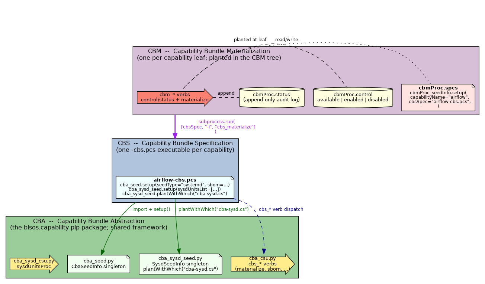

#+title: bisos.capability:  BISOS Capabilities Bundles -- Abstraction, Specification and Materialization
#+DATE: <2024-02-19 Mon 16:27>
#+AUTHOR: Mohsen BANAN
#+OPTIONS: toc:4

#+BEGIN: b:org:pypi:readme/topControls :pkgName "capability" :comment "basic"

|----------------------+------------------------------------------------------------------|
| ~Blee Panel Controls~: | [[elisp:(show-all)][Show-All]] : [[elisp:(org-shifttab)][Overview]] : [[elisp:(progn (org-shifttab) (org-content))][Content]] : [[elisp:(delete-other-windows)][(1)]] : [[elisp:(progn (save-buffer) (kill-buffer))][S&Q]] : [[elisp:(save-buffer)][Save]]  : [[elisp:(kill-buffer)][Quit]]  : [[elisp:(bury-buffer)][Bury]] |
| ~Panel Links~:         | [[file:./py3/panels/bisos.capability/_nodeBase_/fullUsagePanel-en.org][Repo Blee Panel]] --  [[file:/bisos/git/auth/bxRepos/bisos-pip/capability/py3/panels/bisos.capability/_nodeBase_/fullUsagePanel-en.org][Blee Panel]]                                   |
| ~See Also~:            | [[https://pypi.org/project/bisos.capability][At PYPI]] : [[https://github.com/bisos-pip/pycs][bisos.PyCS]]                                             |
|----------------------+------------------------------------------------------------------|

#+END:

* Overview

bisos.capability is the python package for BISOS *Capability Bundles*.
A BISOS capability is a complete piece of functionality (a systemd
service + its packages + its DNS entry + its nginx vhost, or a
non-service software induction like LaTeX+LCNT) declared once and
materialized in one shot on a target host.

The package covers a three-way triad of abstractions --- CBA at the
bottom (the framework, this pip package), CBS in the middle (one
=-cbs.pcs= executable per capability), CBM at the top (one
=cbmProc.spcs= planted per capability leaf). CBM subprocess-invokes
CBS at materialization time and does *not* duplicate CBS content.

#+CAPTION: The CBA / CBS / CBM triad. CBM at top (one cbmProc.spcs pointer + gate + audit per capability leaf) subprocess-invokes CBS in the middle (one -cbs.pcs executable per capability). CBS uses the CBA framework in the bottom tier (this pip package). Load-bearing arrow: the purple =subprocess.run= from CBM to CBS is the visual expression of "CBM sits on top of CBS."

Each of the three tiers in detail:

- *CBA* --- Capability Bundle /Abstraction/. The framework layer.
  Provides =cba_seed.py= (base CBS singleton), =cba_sysd_seed.py=
  (flavor extension for systemd services), =cba_csu.py= (the =cbs_*=
  verb family: =cbs_load=, =cbs_sbom=, =cbs_assemble=, =cbs_materialize=,
  =cbs_reMaterialize=, =cbs_unMaterialize=, =cbs_deMaterialize=,
  =cbs_type=, =cbs_isMaterialized=).

- *CBS* --- Capability Bundle /Specification/. A standalone executable
  =-cbs.pcs= file that declares one capability's contents. Uses
  =cba_seed.setup(seedType=..., sbom=..., ...)= and (for services)
  =cba_sysd_seed.setup(sysdUnitsList=[...])=. Invocable as
  =./foo-cbs.pcs -i cbs_materialize= to install / configure / start
  the whole capability. Example: =/bisos/asc/web/bin/airflow-cbs.pcs=.

- *CBM* --- Capability Bundle /Materialization/. A =cbmProc.spcs=
  planted at a leaf of the CBM tree
  (=sys/cbm/<realm>/<capabilityType>/<capability>/=), gated by a
  sibling =cbmProc.control= file. *Points to* a CBS via =cbsSpec=;
  does NOT duplicate CBS content. When materialized, subprocess-invokes
  the CBS. Provides the =cbm_*= verb family:

  - =cbm_control= / =cbm_status= / =cbm_isEnabled= --- read state
  - =cbm_enable= / =cbm_disable= / =cbm_available= --- write state
    (gate manipulation; never gated themselves)
  - =cbm_materialize= / =cbm_reMaterialize= / =cbm_unMaterialize= /
    =cbm_sbom= --- gated; subprocess-invoke =<cbsSpec> -i cbs_<verb>=

*Load-bearing principle: CBM sits on top of CBS. It does not
duplicate CBS content.* A =cbmProc.spcs= is a ~10-line pointer file
(=capabilityName= + =cbsSpec=); the actual CBS content lives in the
referenced =-cbs.pcs= executable and stays put.

** Files in this package

Framework (existing; ship as-is, don't edit):

- =cba_seed.py= --- =CbaSeedInfo= singleton + =setup()=
- =cba_sysd_seed.py= --- =SysdUnit=, =SysdSeedInfo=, sysd flavor
- =cba_csu.py= --- =cbs_*= verb classes
- =cba_sysd_csu.py= --- =sysdUnitsProc=
- =cbm_csu.py= --- =cbmBase=, =processCbs=

CBM machinery (additive, non-invasive to the above):

- =cbmProc_seedInfo.py= --- =CbmProcSeedInfo= singleton,
  =ControlState= enum (=available=/=enabled=/=disabled=),
  =paramsFromPlantPath()=, =controlRead/Write=, =statusRead/Write=,
  =resolveCbsSpec()=, =leafProcessorNames()=, =walkExamples()=
- =cbmProc_seed.py= --- atexit registrar for =cbmProc-seed.cs=
- =cbmProc_csu.py= --- =cbm_*= Cmnd classes + =_dispatchCbs()= helper
- =bin/cbmProc-seed.cs= --- the CBM-aware seed CSXU
- =sysCbmManage_csu.py=, =bin/sysCbmManage.cs= --- =fullyMaterialize=: =cbm_status= then
  =cbm_materialize= over the platform's tree --- =collective/hereWeb=, then the =pals= realm
  (=sys/cbm/pals/<palsBxo>/<cbm>/=, planted by bisos.pals's =palsOfSys.cs=) when it has a
  =ftoBranchProc.spcs=

An explicit =cbsSpec= path is used as planted, not resolved: a CBS that is a symlink to a generic,
spread-planted file (a PALS site's =cbm/pals-cbs.spcs=) runs by its own path, which is how it finds its
parameters.

** Canonical exemplar

Airflow at
=/bisos/git/auth/bxRepos/bxObjects/bro_rawBisos/bro_rawBisosPlatform/sys/cbm/collective/hereWeb/airflow/=
--- three-file CBM leaf pointing to =airflow-cbs.pcs=.
See [[file:/bisos/git/auth/bxRepos/bxObjects/bro_rawBisos/bro_rawBisosPlatform/README.org][bro_rawBisosPlatform/README.org]] for the realm/capabilityType
layering.

** Tests

=py3/tests/verify.sh= --- 54-assertion smoke suite covering the
singleton, Cmnd class presence, control/status roundtrips,
paramsFromPlantPath, walkExamples coverage, and =cbsSpec= resolution
across absolute-path/slash-path/basename forms.

#+BEGIN: b:org:pypi:readme/pkgDocumentation :pkgName "capability-cs" :comment "basic"

# PYPI Documentation Comes Here in _description.org
#+END:

* Realted Resources

| bisos Capabilities Panel | file:/py3/panels/capabilities/_nodeBase_/fullUsagePanel-en.org |
|                          |                                                                |
| CBM airflow exemplar     | /bisos/git/auth/bxRepos/bxObjects/bro_rawBisos/bro_rawBisosPlatform/README.org |
| Legacy airflow CBS        | /bisos/asc/web/bin/airflow-cbs.pcs                             |
| FTO walker (planted leaves) | /bisos/git/auth/bxRepos/bisos-pip/fileObj/                   |

* Table of Contents     :TOC:
- [[#overview][Overview]]
- [[#realted-resources][Realted Resources]]
- [[#installation][Installation]]
  - [[#installation-with-pip][Installation With pip]]
  - [[#installation-with-pipx][Installation With pipx]]
- [[#part-of-bisos-and-bystar-----bystar-internet-services-operating-system][Part of BISOS and ByStar --- ByStar Internet Services Operating System]]
- [[#bisoscapability-as-a-standalone-piece-of-bisos][bisos.capability as a Standalone Piece of BISOS]]
- [[#documentation-and-blee-panels][Documentation and Blee-Panels]]
  - [[#bisoscapability-blee-panels][bisos.capability Blee-Panels]]
- [[#support][Support]]

* Installation

The sources for the  bisos.capability pip package is maintained at:
https://github.com/bisos-pip/capability.

The bisos.capability pip package is available at PYPI as
https://pypi.org/project/bisos.capability

You can install bisos.capability with pip or pipx.

** Installation With pip

If you need access to bisos.capability as a python module, you can install it with pip:

#+begin_src bash
pip install bisos.capability
#+end_src

** Installation With pipx

If you only need access to bisos.capability as a command on command-line, you can install it with pipx:

#+begin_src bash
pipx install bisos.capability
#+end_src

The following commands are made available:
- seedCapability.cs
- exmpl-capability.cs

* Part of BISOS and ByStar --- ByStar Internet Services Operating System

Layered on top of Debian, *BISOS*: (By* Internet Services Operating System) is a
unified and universal framework for developing both internet services and
software-service continuums that use internet services. See [[https://github.com/bxGenesis/start][Bootstrapping
ByStar, BISOS and Blee]] for information about getting started with BISOS.\\
*BISOS* is a foundation for *The Libre-Halaal ByStar Digital Ecosystem* which is
described as a cure for losses of autonomy and privacy in a book titled: [[https://github.com/bxplpc/120033][Nature
of Polyexistentials]]

/bisos.capability/ is part of BISOS.

* bisos.capability as a Standalone Piece of BISOS

bisos.capability is a standalone piece of BISOS. It can be used as a self-contained
Python package separate from BISOS. Follow the installation and usage
instructions below for your own use.

* Documentation and Blee-Panels

bisos.capability is part of ByStar Digital Ecosystem [[http://www.by-star.net]].

This module's primary documentation is in the form of Blee-Panels.
Additional information is also available in: [[http://www.by-star.net/PLPC/180047]]

** bisos.capability Blee-Panels

bisos.capability Blee-Panels are in ./panels directory.
From within Blee and BISOS these panels are accessible under the
Blee "Panels" menu.

* Support

For support, criticism, comments and questions; please contact the
author/maintainer\\
[[http://mohsen.1.banan.byname.net][Mohsen Banan]] at:
[[http://mohsen.1.banan.byname.net/contact]]

# ###+BEGIN: blee:bxPanel:footerOrgParams :panelType "readme"
#+STARTUP: overview
#+STARTUP: lognotestate
#+STARTUP: inlineimages
#+SEQ_TODO: TODO WAITING DELEGATED | DONE DEFERRED CANCELLED
#+TAGS: @desk(d) @home(h) @work(w) @withInternet(i) @road(r) call(c) errand(e)
#+CATEGORY: U:capability

# ###+END:

# ###+BEGIN: blee:bxPanel:footerEmacsParams :primMode "org-mode" :panelType "readme"
# Local Variables:
# eval: (setq-local toc-org-max-depth 4)
# eval: (setq-local ~selectedSubject "noSubject")
# eval: (setq-local ~primaryMajorMode 'org-mode)
# eval: (setq-local ~blee:panelUpdater nil)
# eval: (setq-local ~blee:dblockEnabler nil)
# eval: (setq-local ~blee:dblockController "interactive")
# eval: (img-link-overlays)
# eval: (set-fill-column 115)
# eval: (blee:fill-column-indicator/enable)
# eval: (bx:load-file:ifOneExists "./panelActions.el")
# End:

# ###+END
